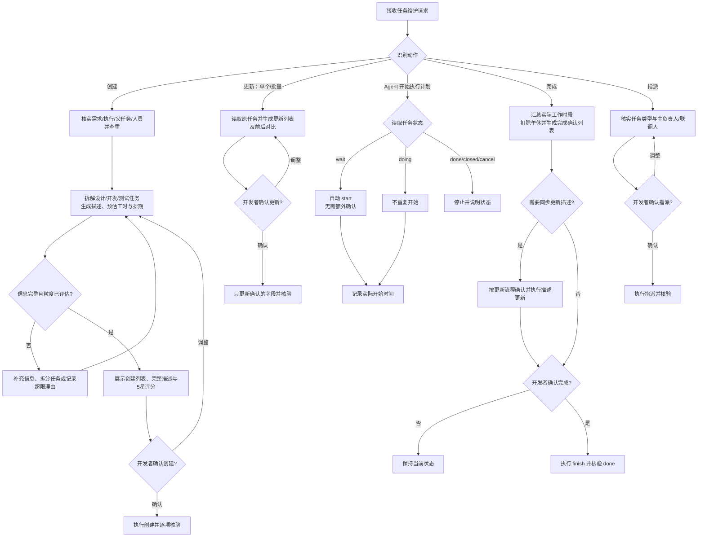

# 道有道开发者禅道任务标准


# 道有道开发者禅道 Skill

## 目标

面向开发者统一禅道任务的数据维护方式，使任务能够追溯到需求，描述能够直接支持 Agent 起步，工时与状态能够反映实际工作。

**REQUIRED SUB-SKILL:** 所有禅道查询和写入均使用 `zentao-cli` 技能（CLI 命令名为 `zentao`）。当前安装版本的 `--help` 是命令、参数和字段依据；不要凭示例猜测 CLI 能力。

适用于设计（`design`）、开发（`devel`）、测试/单元测试（`test`）任务。不适用于 Bug、需求本身或跨团队任务管理。

## 一、整体使用规则流程图



独立横向流程图：[[公司/禅道skill/道有道-禅道SKILL-流程图.excalidraw]]

> [!important] 确认边界
> 创建、更新、完成、指派必须对最终操作内容取得开发者明确确认。**唯一例外：Agent 开始执行实现计划时，可自动开始当前任务。** 写入后必须重新读取核验；超时或结果不明确时，先查询，禁止盲目重试。

## 二、通用硬规则

1. **先读后写**：按准确 ID 读取需求、执行和任务；核对名称、状态、所属范围及关联关系。候选不唯一或信息矛盾时先澄清。
2. **需求绑定（强制）**：所有设计、开发、测试任务都必须关联需求。创建时通过原生 `story` 字段绑定已核实的需求，并确认所属 `executionID`；仅在描述中提及需求 ID 不算绑定。更新时发现任务未绑定有效需求，先补充并确认需求关联，再执行其他写入。
3. **父任务绑定（可选）**：任务存在父任务时，核实父任务 ID、状态和所属执行，通过当前 CLI 暴露的原生 `parent` 字段关联，具体字段以 `--help` 为准。CLI 不支持时说明限制，不把父任务 ID 写入描述代替原生关联。
4. **确认最终草稿**：用户最初说“创建”“直接改”只代表提出需求，不等于授权最终字段。展示完整操作内容后，取得“确认创建/更新/完成/指派”等明确答复再写入。
5. **授权不扩散**：一次确认只覆盖当次列出的任务和字段。任务数量、描述、工时、时间、需求、父任务、指派对象或操作范围变化后，必须重新确认。沉默或仅提出调整均不是确认。
6. **只改目标字段**：更新前读取当前值；目标值已经正确时不重复写入。不得顺带修改未确认的需求、父任务、优先级、工时、日期、状态或指派人。
7. **原生字段优先**：类型、优先级、指派人、工时、日期、需求、父任务和状态写入对应原生字段，不用描述或备注替代。
8. **不编造事实**：未确认的需求规则、实现细节、依赖和验证结果不得写成事实；非阻断性未知项标为“待确认”。
9. **批量逐项可见**：批量操作使用同一确认清单；执行后分别报告成功、失败、跳过及原因，不把部分成功汇报为整体成功。
10. **写入防重**：创建或完成请求超时、连接中断、响应异常时，先按任务 ID 或需求、名称、指派人、近期创建时间查询。结果仍不明确则停止并报告，不整体重试。
11. **写后核验**：重新读取任务，核对关键字段和状态；未核验前不得声称已创建、已关联、已指派或已完成。
12. **凭证安全**：不得读取、打印或询问密码、Token。认证问题按 `zentao-cli` 规则交由用户交互处理。

## 三、任务类型与粒度标准

| 任务类别 | CLI 类型 | 常规工时上限 | 基本要求 |
|---|---|---:|---|
| 设计 | `design` | 6h | 输出明确设计成果，可供后续实现或评审 |
| 开发 | `devel` | 4h | 输出可验证的功能、接口、数据或集成能力 |
| 测试（单元测试） | `test` | 6h | 输出可执行的测试及明确验证范围 |

- 超过常规上限时优先拆分；若任务边界内聚、拆分反而增加协调成本，或有其他合理原因，可以保留，但必须在创建列表中标注“超限”并说明理由，经开发者明确确认后创建。
- 默认一个任务由一名主负责人负责；单元测试任务需要两人联调时，明确一名主负责人和一名联调人，并随创建或指派列表确认。一个任务只承担一种主要任务类型，并具有可独立验证的完成标准。
- 设计、开发、测试原则上分开；简单且低耦合的开发事项可合并，开发任务超过 4h 时按上述超限规则处理。
- 外部服务、消息、定时任务等易形成独立卡点的事项，优先单独拆分。
- 当前不设置最小工时；任务粒度标准后续与各开发者评审后更新。新标准发布前，按本表常规上限进行粒度评估。
- 当前“测试”任务以单元测试为主；如扩大到其他测试类型，先由团队确认类型和粒度标准。

## 四、优先级、预估排期与实际工时

### 4.1 优先级

- 创建任务时读取关联需求的优先级，任务 `pri` 跟随需求，不默认写成 3。
- 无法取得需求优先级时，先补充查询或澄清，不提交任务。
- 需求优先级后续变化时，不自动批量修改任务；如需同步，走任务更新确认流程。

### 4.2 预估工时与排期

- 可根据需求、设计资料和实现计划提出预估工时，但必须连同拆分依据交给开发者确认。
- 时区使用 `Asia/Shanghai`；所有预估工作时段均跳过午休 **12:00–13:30**。
- 默认排期口径为确定预计首末日期；开发者要求或需要展示具体工作安排时，再计算时分时段。两种口径均必须跳过午休。
- 需要具体时刻排期时，先取得上下班时间及休息配置；不得虚构班次。跨午休时拆成连续工作段计算，午休不计入工时。
- 周末、节假日和其他休息日按用户或项目日历处理；没有配置时不擅自假定。
- CLI 只支持日期级字段时，`estStarted`、`deadline` 只保存首末工作日期；具体时段仅用于计算和确认，不声称禅道保存了时分精度。

### 4.3 实际工时

- 实际工时按已核实的实际工作段求和，并扣除与 **12:00–13:30** 的重叠时间；夜间、周末及其他非工作中断不得计入。
- 优先以 Agent 自动开始后记录的实际开始时间、完成前核实的实际结束时间形成工作段；存在暂停或分段时逐段记录，不把整段自然时间直接当作工时。
- Agent 在本次执行上下文中维护“开始、暂停、恢复、结束”工作段清单。禅道只写入当前 CLI 支持的原生字段；无法用原生字段表达多个不连续时段时，经开发者确认后可在完成备注中保留实际分段。
- 示例：实际工作记录为 11:00–14:00，则工时为 `1h + 0.5h = 1.5h`，不是 3h。
- 不得直接复制预估工时作为实际工时。实际开始、结束或工作段不完整时，先向开发者核实。
- 需要取整时，必须在完成确认中展示原值和取整值；不得静默调整。

## 五、任务描述模板与质量评分

### 5.1 两段式描述模板

每个任务描述只使用以下两个主部分。内容应提取本任务相关需求，不粘贴整份 PRD 或无关日志。

```markdown
## 一、需求理解及对应范围
- 关联需求：#<需求ID> <需求标题>
- 需求理解：<要解决的问题、相关业务规则和预期结果>
- 覆盖范围：<全部需求，或明确到功能点/章节的部分需求>
- 不包含：<需要澄清边界时填写>
- 验收标准：<可观察、可验证的完成结果>

## 二、实现计划及 Agent 起步 Plan
- 实现思路：<本任务的技术路径和关键约束>
- 前置依赖：<依赖任务、接口、数据或文档；没有则写“暂无已知依赖”>
- 交付物：<设计文档、接口、类、脚本、测试等实际交付内容>
- Agent 起步 Plan：
  1. <起步时要读取的资料、代码和需要确认的约束>
  2. <实现或设计步骤>
  3. <验证步骤及预期结果>
```

- 需求关联不能替代原生 `story` 绑定。
- 描述中不重复记录指派人、优先级、预估工时、预计日期和状态。
- 实现过程中发生范围或方案调整时，更新为当前真实计划，不保留已经失效的 Agent 起步步骤。

### 5.2 描述质量评分（满分 5 星，仅供参考）

创建任务前自动评分，并在创建列表中显示总星数和各维度扣分原因。评分前必须对照实际需求、所属项目/执行和当前实现计划，而不是只检查文本格式。评分衡量**描述完整性与可起步性**，不衡量需求价值、开发质量或任务完成度，也不作为创建阻断条件。每个维度得 0、0.5 或 1 星，总星数为五个维度之和，按 `X/5 星` 展示，支持 0.5 星步进。

| 维度 | 1 星标准 | 0.5 星标准 | 0 星标准 |
|---|---|---|---|
| 需求追溯 | 需求已核实，覆盖全部/部分范围明确 | 有关联需求，但范围笼统 | 未关联、关联错误或范围矛盾 |
| 需求理解 | 目标、规则和预期结果准确清晰 | 只有功能概述，规则不完整 | 只有任务名或理解明显偏差 |
| 边界与验收 | 边界清楚，验收结果可观察验证 | 有验收描述但不可测，或边界不全 | 无有效验收标准 |
| 实现与交付 | 技术路径、依赖和交付物明确 | 有步骤但依赖或交付物不完整 | 只有“开发/实现”等空泛表述 |
| Agent 可起步性 | 起步资料、执行步骤和验证方式可直接执行 | 能起步但仍需补充关键步骤 | 无法据此开始工作 |

评分规则后续可由团队调整；评分维度、权重、判定口径和展示阈值均可更新，但不改变“仅供参考、不替代人工确认”的原则。

## 六、任务创建

1. **核实输入**：确认需求 ID、所属执行、主负责人及需求资料；读取需求标题、状态、优先级和相关内容。需求无法核实或不匹配时停止创建。存在父任务时同步核实父任务；单元测试需要两人联调时，同时确认联调人。
2. **检查重复**：在目标执行中比较同需求、同工作范围的未完成任务。名称相似但范围不同不算重复；疑似重复时列出候选让开发者选择。
3. **拆解任务**：按设计、开发、测试及实际依赖拆分；逐项进行粒度检查并明确验收标准和交付物，超限任务记录合理保留理由。
4. **生成草稿**：填写名称、类型、需求、可选父任务、优先级、主负责人、可选联调人、预估工时和排期；按两段式模板生成描述并进行 5 星评分。
5. **提交确认**：无论单个还是批量创建，都先展示创建确认列表，再展示每个任务的完整描述。单个创建使用一行列表，批量创建逐行列出。开发者可以增删任务或调整任何字段；调整后重新展示受影响内容并确认。

创建确认列表格式：

| 序号 | 任务名称 | 类型 | 需求 | 父任务 | 优先级 | 主负责人/联调人 | 预估工时 | 预计首末日期（具体时段仅确认用） | 描述评分（X/5 星） | 粒度检查/超限理由 |
| --- | --- | --- | --- | --- | ---: | --- | ---: | --- | ---: | --- |

无父任务或非联调任务填“无”；单元测试需要两人联调时，必须分别列出主负责人和联调人。

6. **执行创建**：明确确认后，按依赖顺序逐项调用当前 CLI 支持的 `task create`。不得超出已确认清单。
7. **处理部分失败**：记录失败项并继续处理不依赖它的剩余项；依赖失败项的任务跳过。不得整体重试已成功项目。
8. **核验结果**：读取返回的任务 ID，核对需求、父任务、类型、优先级、主负责人、联调人、预估工时、日期和描述，汇总成功、失败、跳过清单。

## 七、任务更新

1. 确认准确任务 ID，读取当前描述及本次涉及字段；批量更新时逐项读取。
2. 只根据实际实现变化生成更新内容，不覆盖仍有效的需求理解、依赖和验收信息。
3. 无论单个还是批量更新，都先生成更新确认列表，逐项比对更新前后内容；描述更新还需展示完整的新描述，不得只写“按最新方案实现”。

更新确认列表格式：

| 任务 ID | 任务名称 | 更新字段 | 更新前 | 更新后 | 更新原因 |
|---|---|---|---|---|---|

4. 取得开发者对最终变更的明确确认后，仅更新确认的字段。批量确认必须列明全部任务 ID；任一任务的字段或内容调整后，重新展示该任务的前后对比。
5. 每项只写入一次并重新读取核验；分别报告成功、失败和跳过项。目标值已正确时标记“无需更新”。

## 八、Agent 自动开始任务

1. 触发点是**当前 Agent 已选定任务并开始执行实现计划**，不是仅讨论需求或生成候选计划。
2. 开始前读取任务状态、当前指派人及实际开始字段，确认该任务属于当前开发工作。
3. 状态为 `wait` 时，直接执行当前 CLI 支持的 `task start`，无需额外确认；这是团队确认规则的唯一自动写状态例外。
4. 状态为 `doing` 时不重复开始，沿用已核实的实际开始时间。
5. 状态为 `done`、`closed` 或 `cancel` 时停止，不通过重新开始规避状态限制；任务归属不清时先澄清。
6. 开始后读取任务核验状态，并记录实际开始时间供完成时计算工时。自动开始不代表自动完成，也不授权修改描述或工时。

## 九、任务完成

1. **完成必须人工确认**：代码写完、测试通过或 Agent 自评完成，都不能替代开发者对任务完成的明确确认。
2. 完成前读取任务状态、实际开始时间和已有消耗工时；已为 `done` 时不重复写入，已为 `closed` 或 `cancel` 时停止。
3. 无论单个还是批量完成，都先生成完成确认列表，逐项汇总实际完成内容、验证结果、遗留问题、实际工作段和扣除午休后的工时。信息不足时先核实，不用预估值补齐。

完成确认列表格式：

| 任务 ID | 任务名称 | 实际开始 | 实际结束/工作段 | 实际工时 | 完成内容 | 验证结果 | 遗留问题 | 联动描述更新 |
|---|---|---|---|---:|---|---|---|---|

4. 如需同步更新描述，先按第七节生成更新确认列表，并在完成确认列表的“联动描述更新”列标明范围；可在同一条确认消息中提交“更新列表 + 完成列表”，但两项操作必须分别明确。
5. 开发者明确确认完成列表后，按当前 CLI 帮助映射实际开始、完成时间和本次实际工时（常见字段为 `realStarted`、`finishedDate`、`currentConsumed`）。除非当前接口明确要求，不同时写入累计 `consumed`。
6. 完成备注只记录实际结果、验证和后续事项；不重复任务元数据，不编造未执行的验证。
7. 使用 `task finish` 而非关闭任务；写入后重新读取并确认状态为 `done`。结果不明确时先查询，不重复完成。

## 十、任务指派与单测联调

1. 读取任务类型、当前指派人和状态。默认只设置一名主负责人，并解析为唯一、可执行指派的禅道账号；不得仅凭同名或电脑用户名猜测。
2. 单元测试任务需要两人联调时，分别解析两名不同人员的禅道账号，明确**主负责人**和**联调人**；两人角色不得含混。
3. 展示任务 ID、名称、类型、当前与目标主负责人；单测联调任务还要展示当前与目标联调人。批量指派逐项列出。
4. 取得开发者明确确认后，主负责人使用当前 CLI 支持的指派动作或原生 `assignedTo` 字段写入；联调人使用当前 CLI 暴露的原生团队/协作字段写入，具体能力以 `--help` 为准。
5. CLI 不支持多人或协作字段时，停止双人写入并说明限制；只能在开发者再次确认后写入主负责人，不得声称已完成双人指派，也不得把联调人塞入不支持的字段。
6. 只修改确认的人员字段，不顺带接受、开始或完成任务；写入后重新读取，核验主负责人及可用时的联调人。

## 十一、异常与停止条件

| 情况                 | 处理                           |
| ------------------ | ---------------------------- |
| 需求、执行或任务候选不唯一      | 列出候选的 ID、名称、状态和匹配依据，等待选择     |
| 需求无法核实、已删除或与任务无关   | 停止创建，不建立无需求或错误关联任务           |
| 父任务不存在、跨执行或关联冲突 | 停止父任务关联并澄清，不用描述代替原生字段 |
| 单测联调人员或角色不明确 | 先明确主负责人和联调人，再提交指派确认 |
| 任务超过常规工时上限 | 优先拆分；合理保留时在创建列表中标注超限及理由，经确认后创建 |
| 创建/完成超时或结果未知       | 先查询是否生效；仍不明确则停止并报告           |
| 批量部分失败             | 分别报告成功、失败、跳过；不整体重试           |
| CLI 不支持所需字段或动作     | 查当前 `--help`，说明限制；不把字段塞进描述代替 |
| 认证失败或权限不足          | 不重复写操作，按 `zentao-cli` 错误规则处理 |
| 本地没有可用 `zentao` 命令 | 停止写入，提示检查安装或 PATH；不得虚构执行结果   |

## 十二、操作速查

| 动作  | 写前确认                       | 写后核验重点             |
| --- | -------------------------- | ------------------ |
| 创建  | 必须：创建列表、需求、可选父任务、人员角色、完整描述、5 星评分、工时排期及超限理由 | 任务 ID、需求/父任务关联及全部关键字段  |
| 更新  | 必须：更新列表、前后对比及任务范围          | 仅目标字段变化            |
| 开始  | `wait → doing` 自动执行，无需额外确认 | 状态与实际开始时间          |
| 完成  | 必须：完成确认列表、实际工时、验证及联动更新范围 | 状态为 `done`，实际字段正确  |
| 指派  | 必须：当前与目标主负责人；单测联调时包含联调人 | `assignedTo` 为目标主负责人，联调字段按 CLI 能力核验 |

执行前按当前安装版本查询帮助：

```bash
zentao task create --help
zentao task update --help
zentao task start --help
zentao task finish --help
```

## 禁止事项

- 禁止创建未关联需求的设计、开发或测试任务。
- 禁止用描述冒充父任务关联，或在 CLI 不支持时声称已完成双人指派。
- 禁止未经最终草稿确认直接创建、更新、完成或指派。
- 禁止把自动开始扩展为自动完成或自动修改其他字段。
- 禁止默认优先级、把午休计入工时，或未说明理由、未经确认直接提交超限任务。
- 禁止只写“完成开发”“按最新方案实现”等无法起步或验证的描述。
- 禁止盲目重试超时写入、用关闭代替完成、用描述代替原生字段。
